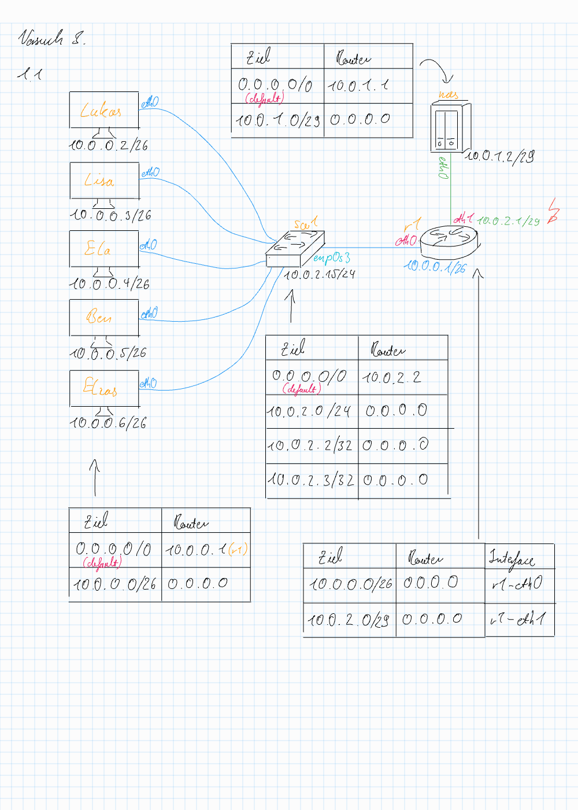

# Antworten zu Versuch 3

## 3.1

### 1.1 & 1.2

### 1.3

Alle Teammitglieder können sich mittels eines pings gegenseitig erreichen.

### 1.4

mininet> ben ping -c 5 nas\
PING 10.0.1.2 (10.0.1.2) 56(84) bytes of data.\
From 10.0.0.1 icmp_seq=1 Destination Net Unreachable\
From 10.0.0.1 icmp_seq=2 Destination Net Unreachable\
From 10.0.0.1 icmp_seq=3 Destination Net Unreachable\
From 10.0.0.1 icmp_seq=4 Destination Net Unreachable

Die Teammitglieder sind nicht in der Lage den NAS zu erreichen, da dieser mit der Konfiguration in einem unerreichbaren Netz hängt.

### 1.5

Problem war, dass der Router für r1-eth1 auf das Netz 10.0.**2**.0/29 gezeigt hat, was den IP-Addressbereich 10.0.2.1 bis 10.0.2.7 abdeckt. Allerdings ist der NAS mit der IP 10.0.1.2/29 versehen, womit er im Netz 10.0.**1**.0 liegt. Ebenfalls ist sein Default-Gateway für das Netz mit 10.0.1.1 konfiguriert.

Zwei Möglichkeiten:

1. Man ändert die IP-Addresse des NAS auf eine im Netz 10.0.2.0/29, bspw. 10.0.2.2/29. Hier noch wichtig, dass das Default-Gateway des NAS zu 10.0.2.1 angepasst wird.

2. Man ändert das Gateway-Addresse im Router am Interface r1-eth1 zu 10.0.1.1/29 

## 3.2

